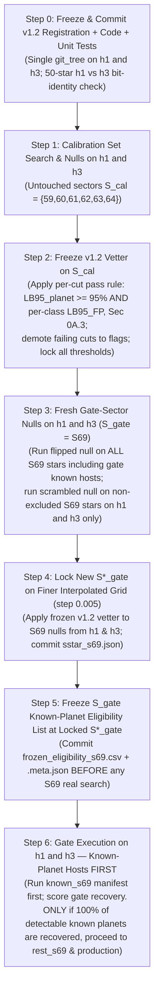

# Astrolab Exoplanet Search — v1.2 Registration

- **Status**: **REGISTERED (pending tag)** — 2026-11-13 and 2026-11-18 room decisions are folded in. The Section 0B preconditions have passed at commit `dfff52f` (details below). This document is the v1.2 registration; it is not in force until the registration tag is applied. Formerly `registration_v1.2_DRAFT.md`.
- **Date**: 2026-11-18
- **Code Reference**: branch `v1.2-vetter-unify` at `dfff52f` (`dfff52fb8785237eb08e160072bf5d960cc86e24`), tag `v1.2-step6-frozen-settings`. The step-5c ancestor is `0977818` (`097781843d7a5a943fe1749f9e0c112d268b704b`, tag `v1.2-step5c-toodeep-setting`); tags `v1.2-step1-vetter-unify` through `v1.2-step5c-toodeep-setting` remain on the same branch.
- **Search-Path Hash** (computed at commit `0977818` with `exoplanet_search/docs/preregistration/v1.1_early_nulls_2026-11-11/searchpath_hash.py`; unchanged at `dfff52f`): `b9e5ebea8f84b05d60491e871f2c19e3facda75bdb146f3ab46eead42dafa4f4`. Because the hash is unchanged, the S70 detection-column bit-identity check applies at `dfff52f`.
- **Base Commit**: `dde1e6ba` (`exoplanet-search`)
- **Predecessor**: v1.1 (`fb958a4e` search-path hash; Sector 72 known-planet gate failed at $28/30 = 93.3\%$ on 2026-11-12 due to `HAT-P-43 b` [`odd_even` at $3.17\sigma$ / $17.55\%$] and `TOI-6894 b` [`too_deep` at $5.04\% > 5.0\%$ around an $R_\star = 0.228\,R_\odot$ M dwarf], after which the v1.1 vetter was frozen without further amendment).

---

## 0. Scope and Governing Principles

1. **Zero Compute Before Sign-Off**: Every calibration dataset, sector assignment, statistical pass rule, vetting definition, threshold interpolation rule, and execution ordering in this document is specified and frozen **before** any v1.2 search, null, injection, or calibration job is launched.
2. **Principled Empirical Cut Calibration**: No automated light-curve vetting cut may act as a hard rejection in v1.2 unless it independently proves **both** high planet retention (one-sided 95% lower confidence bound $\ge 95\%$) **and** non-trivial false-positive / eclipsing-binary rejection on an untouched multi-sector calibration set. Any cut that fails either requirement is demoted from a hard rejection (`passed_lc_checks`) to an informational diagnostic flag (`flag_<cut>`).
3. **Strict Holdout Separation**:
   - The **v1.2 Calibration Set** ($\mathcal{S}_{\text{cal}}$) is drawn exclusively from TESS sectors never previously touched in Astrolab.
   - The **v1.2 Gate Sector** ($S_{\text{gate}}$) is a separate untouched TESS sector disjoint from $\mathcal{S}_{\text{cal}}$, with its own pre-run frozen known-planet eligibility list and zero target overlap with the calibration tuning set.
   - The **20% random per-sector holdout** (`holdout.is_holdout(tic, sector)` with `HOLD_FRAC = 0.20`, `SEED = 20261110`) remains blinded throughout calibration.

---

## 0A. Room-Agreed Amendments (2026-11-13) — Supersede Any Conflicting Text Below

These changes were agreed in review after the first draft was written. Where later sections disagree, this section governs.

1. **Sectors (replaces the 10-sector set $\{56,58,61,63,67,73,74,76,77,81\}$, gate S79, and the reserve list).**
   - **Calibration set** $\mathcal{S}_{\text{cal}} = \{59, 60, 61, 62, 63, 64\}$ (Cycle 5, 200-s FFIs). ExoFOP census (2026-11-13, excluding S70–S72): **157 unique CP/KP** at ExoFOP SNR 7–30 (**61** at 7–15, **96** at 15–30), **231 TFOPWG FPs**, **7 FAs**.
   - **Gate sector** $S_{\text{gate}} = \text{S69}$: **96 CP/KP**, **37 FPs** by ExoFOP. The gate scores **only S69 planets that are not in the calibration set** (46 by ExoFOP; **at least 30 required**).
   - Both frozen known-planet lists (calibration and gate) come from **our own eligibility filter** ($S^* \le S_{\text{exp}} \lesssim 2 S^*$, and at least the gate's minimum transit count), not from ExoFOP's listed counts. The ExoFOP numbers above are availability estimates only.
   - Table 1 and the Section 3.4 reserve list are kept for the record but are superseded.
2. **Planet retention.** Each cut needs an exact binomial (Clopper-Pearson) one-sided 95% lower bound on retention $\ge 0.95$ ($n = 150$ allows 2 lost; $n = 157$ allows 3). Only eligible planets count. **Pre-declared fallback:** if fewer than 150 eligible planets remain after filtering, pad with injections into the same sectors' real light curves, scored by the same rule. The bound is never relaxed. Calibration uses non-holdout stars only (`exosearch.holdout`: `SEED = 20261110`, `FRACTION = 0.20`), so the ExoFOP census of $\sim 157$ unique CP/KP on S59–S64 becomes $\sim 126$ before the eligibility filter, which is already below 150 and therefore triggers padding. The padding procedure is Section 0A.2.1.

#### 0A.2.1 Injection-padding specification — **PROPOSED, needs Scientist sign-off**

This subsection pins the padding that Section 0A.2 requires. Values taken from existing injection code or configs are cited. Values that are not in the code (the sequential stopping rule, the $+20$ margin, jitter widths, host-retry caps, and the real-only exception) are proposed and marked as such. The v1.1 S70/S106 campaign (`configs/injection_v1.1.json`, seed `70106`, `hosts_per_sector = 4000`) is a completeness campaign, not this pad; its seed and host count are not reused. There is no reserve batch and no fixed injection count of 250.

1. **When and how many (proposed stopping rule).** After $S^*_{\text{cal}}$ and $n_{\text{real,eligible}}$ are known, and **before any cut's retention is scored**, draw and inject sequentially until
   $$N_{\text{pad}} = \max(150 - n_{\text{real,eligible}},\ 0) + 20$$
   padded planets survive the trim to $[S^*_{\text{cal}}, 2S^*_{\text{cal}}]$ (and meet `min_transits = 3`). The margin $+20$ is fixed now: if $n_{\text{real,eligible}} \ge 150$, still add 20. The sequence is deterministic given seed `20261118`. The stopping point depends only on these counts, never on vetter results. **Hard cap: 2000 draws.** If the cap is hit before $N_{\text{pad}}$ is reached, stop, record the shortfall, and do not relax the Clopper-Pearson bound.
2. **Seed and host order (scheme from `inject.py`).** Base seed `20261118` (a new v1.2 padding seed, the same calendar date as the S70 bit-identity random-star seed, not the S70/S106 campaign seed `70106`). Per-host and per-draw seeds use `exosearch.inject.seed_for(base, sector, run, tic) = int.from_bytes(sha256(f"{base}:{sector}:{run}:{tic}").digest()[:4], "big")`. A single eligible-host list in S59–S64 is built with the exclusions and Tmag $\times$ $R_\star$ stratification below and walked in the seeded stratified order given by `seed_for(20261118, sector, -1, 0)` (as `select_hosts` does). One injection per host (`one_injection_per_lc_per_run: true` in `configs/injection_v1.json`); a used host is not reused.
3. **Host exclusions (from the injection code, with the registered EB catalog).** A host must be all of: a SPOC 2-min star in S59–S64; **non-holdout** (`holdout.is_holdout(tic)` is false; `exosearch/holdout.py`, `SEED = 20261110`, `FRACTION = 0.20`); **gate-disjoint** (the TIC is not on the S69 frozen known-planet / active-TOI list); **no known TOI** (`labels.toi_table()`, as `inject.select_hosts` / `injection_v1.1.json` `exclude: ["toi_hosts", ...]`); **no Kostov et al. 2025 (ApJS 279, 50) EB signal** (Section 0A.4; this replaces the Prša 2022 exclusion that `select_hosts` still uses for the v1.1 campaign). Stratification uses `configs/injection_v1.1.json` (`tmag_edges = [0, 9, 10.5, 12, 13.5, 20]`, `rstar_edges = [0, 0.7, 1.2, 2.0, 100]`), then fills from the remainder if a cell is short, as `select_hosts` does. Require a valid TIC $R_\star > 0$ and $T_{\mathrm{mag}}$, as `select_hosts` does.
4. **$(P, R_p, b)$ by resampling real CP/KP with jitter (resampling agreed; jitter widths proposed).** Each draw takes a donor, with replacement, from the non-holdout S59–S64 confirmed transiting CP/KP that have catalog period and radius (not conditioned on $S^*_{\text{cal}}$). Copy $(P, R_p, b)$, apply independent Gaussian jitter, and **keep $R_p$ exactly as drawn** (after the clip below; no further adjustment to hit an SNR target):
   - $P$: multiplicative jitter with $\sigma = 0.001$ (0.1% fractional), then clipped to the searched range $[0.5, 13.5]\,\mathrm{d}$ and to no more than half the host baseline. The $[0.5, \text{half baseline}]$ support is `configs/injection_v1.1.json` `draws.period` / `inject.py`; the 0.1% width is proposed (not in the code).
   - $R_p$: multiplicative jitter with $\sigma = 0.05$ (5% fractional), then clipped to
     $$\bigl[0.5\,R_\oplus,\ \max\bigl(1.05 \times \max R_p^{\text{real}},\ 2.2\,R_{\mathrm{J}}\bigr)\bigr],$$
     where $\max R_p^{\text{real}}$ is the maximum catalog $R_p$ among the real non-holdout S59–S64 CP/KP and $2.2\,R_{\mathrm{J}} = 2.2 \times 11.209\,R_\oplus = 24.6598\,R_\oplus$, written $24.66\,R_\oplus$. The lower bound $0.5\,R_\oplus$ is `configs/injection_v1.1.json` `draws.rp_earth`; the upper bound is proposed so that a 5% jitter above the sample maximum is kept, and so inflated planets remain and the $\{22, 25, 30\}\,R_\oplus$ cap is tested. The previous $[0.5, 20]\,R_\oplus$ clip is withdrawn.
   - $b$: additive jitter with $\sigma = 0.05$, then clipped to $[0, 1]$. The $[0, 1]$ support is `configs/injection_v1.1.json` `draws.b` / `inject.py`; the 0.05 width is proposed. If the donor has no catalog impact parameter (`pl_imppar`), draw $b \sim \mathrm{Uniform}[0, 1]$ as that same config, then apply the jitter.
   - If the orbit is unphysical ($a/R_\star \le 1+k$), as in `inject.run_one`, this draw is discarded and counts toward the redraw cap in item 5.
5. **Host assignment; expected SNR is not drawn.** $S_{\mathrm{exp}}$ uses the same eligibility formula as Section 2.2 / `known_planets` freeze-eligibility: $S_{\mathrm{exp}} = 0.66 \times \delta \, f_{\mathrm{ap}} / \mathrm{CDPP}(D) \times \sqrt{n_{\mathrm{tr}}}$, with `expected_s_scale = 0.66` from `configs/v1.1.json` (`known_planets.expected_s_scale_source`: median $S_{\mathrm{obs}}/S_{\mathrm{exp}}$ of period-matched injections in the v1.0.0 `injection_v1` products, runs 0 and 1) and `min_transits = 3` (`configs/v1.1.json`; Section 0A.5). **$S_{\mathrm{exp}}$ is not drawn** (no uniform or log-uniform draw on SNR); it follows from the resampled real $(P, R_p, b)$ and the host. For each $(P, R_p, b)$ draw, walk the unused hosts in the seeded stratified order and assign the first eligible unused host whose $S_{\mathrm{exp}}$ lies in $[6.855, 41.13]$ (that is $[0.5, 3] \times$ the v1.1 $S^* = 13.71$) and whose expected transit count is at least 3. **Retry cap:** if no host in the first 200 candidates fits, discard that $(P, R_p, b)$ draw and redraw, at most 20 redraws per slot; then the slot is left empty and recorded (it does not count toward $N_{\text{pad}}$, but the attempts count toward the 2000-draw cap). After assignment, the injection is searched, and it counts toward $N_{\text{pad}}$ only if it survives the written trim $S^*_{\text{cal}} \le S_{\mathrm{exp}} \le 2S^*_{\text{cal}}$ with at least 3 surviving transits. Because drawing starts only after $S^*_{\text{cal}}$ is known, a host whose $S_{\mathrm{exp}}$ lies outside that eligibility window is skipped, so every counted injection already satisfies the trim.
6. **Epoch, eccentricity, and transit model (from `injection_v1.1.json` / `inject.py`).** $e = 0$. $t_0$ is uniform within one period of the data start. The model is `batman`, circular, quadratic limb darkening from Claret 2017 TESS tables at the host TIC $T_{\mathrm{eff}}/\log g$, supersample 1. The signal is multiplied into the normalised PDCSAP flux of every cadence before quality masking, prewhitening, and detrending. The v1.1 `wrong_density` 25% subset is **not** used: that subset is a density-check test in `configs/injection_v1.1.json`, not a planet-retention pad.
7. **Scoring and the real-only rule (agreed).** Padded injections are scored by the same eligibility and cut-retention rule as the real calibration planets (Section 0A.2). Report **real-only retention next to padded retention**. Each cut must also pass on the real-only count: a cut fails if it loses more real planets than the Clopper-Pearson $0.95$ lower bound allows at the real $n$. If $n$ is too small for any loss to fit that bound (Section 3.1: one loss requires $N_p \ge 93$), **at most 2 real losses** are allowed, and each must be traced to a rule. **The S69 known-planet gate stays at zero losses** (Section 0B.1); this real-only exception is for calibration cut retention only.

3. **False-positive rule (per class; replaces Section 3.2).** There is no single pooled bound per cut over all FPs.
   - Each cut needs the planet-retention bound (item 2) **and** a Clopper-Pearson FP-rejection lower bound measured **only on the FP class it targets**: odd-even and secondary eclipse on eclipsing binaries; radius/depth caps on stellar companions.
   - Each of the 231 FPs is assigned one class (eclipsing binary, stellar companion, contamination, or unknown) from ExoFOP comments by a **written rule, without seeing cut outcomes**. The labelled list is committed **before any calibration scoring**.
   - Minimum sample per class: **30** (30/30 rejected gives a lower bound of about 0.905). A class below the minimum in S59–S64 is padded from Kostov et al. 2025 (ApJS 279, 50) eclipsing binaries; if it cannot be padded, the cut is reported as **unmeasured, not passing**.
   - The whole vetter gets **one combined FP-rejection lower bound** on the same frozen labels, with the unknown class kept in the denominator, against a target set before scoring (**target: TBD in review**).
   - A cut that keeps planets but rejects nothing in its own class becomes a **flag**.
4. **EB source.** Prša et al. 2022 covers only S1–S26, so EB checks for S59–S64, S69 and S70 use **Kostov et al. 2025 (ApJS 279, 50)** from CDS. Prša-based EB counts in Table 1 are superseded.
5. **`few_transits` is a detection definition, not a cut to calibrate.** Completeness counts only injections that meet the gate's minimum transit count, and the injection grid is restricted to match.
6. **S70 diagnostics context.** The largest injection losses came from `variable` (145 first-failing) and `density_mismatch` (128 first-failing; 241 counting every failing rule). The depth cap rejected none. A vetter-version audit is checking whether these were scored with the old vetter, so **the calibration targets depend on the outcome of that audit**.

---


## 0B. Room-Agreed Amendments (2026-11-18) — Supersede Any Conflicting Text Below

These changes were agreed on 2026-11-18 (Saketh; Scientist and RF Engineer review). They supersede later sections where the two disagree, and they supersede Section 0A only where the two disagree. Section 0A otherwise stands, including the S59–S64 / S69 sector assignment, the per-cut Clopper-Pearson retention and per-class FP rules, Kostov et al. 2025 as the EB source, `few_transits` as a detection definition, and the vetter-audit dependency.

1. **S69 known-planet gate: zero losses.** Saketh's rule: the S69 gate may lose **zero** known planets after vetting. Search misses on the frozen required set are also zero. Known-planet recovery is the first gate, and nothing else counts until it passes.
   - **Real run**: every detectable confirmed planet on the frozen S69 eligibility list (`disp == 'confirmed'`, `eligible == True` at $S^*_{\text{gate}}$) must be recovered (period match as in Section 2.2, $S_{\text{found}} \ge S^*_{\text{gate}}$, and `passed_lc_checks_v12 == True`). One miss fails the gate.
   - **Flipped (`invert`) null**: known planets must vanish (no transit-induced tail leakage on those hosts).
   - **Scrambled (`scramble`) null**: known hosts remain excluded from the $S^*$ fit, as in v1.1. Any scrambled-null survival on a known host is a diagnostic only and is not part of the $S^*$ sample.
   - This replaces the Section 2.2 / Section 7.3 alternative that would have allowed a 90% Clopper-Pearson lower bound when $N_{\text{req}} \ge 30$. There is no such alternative. (The Section 0A.2 allowance of 2–3 losses is only for *per-cut calibration retention* on S59–S64, which decides whether a cut stays a hard rejection or is demoted to a flag. It does not apply to the S69 gate.)

2. **`too_deep` is a flag, not a cut.** Registered setting: `vet.too_deep.mode = 'flag'` (with `max_depth` default $0.05$). A 5% depth excess is recorded and is not a rejection. Once the radius cap uses $R_p-2\sigma$ with $R_\star$'s error included, it covers the stellar-companion case; a fixed 5% depth cut would reject giants around M dwarfs (e.g. `TOI-6894 b`). This supersedes any reading of `not_too_deep` / `max_depth` as a v1.2 hard cut.

3. **Radius cap on $R_p - 2\sigma$, with $R_\star$ uncertainty.** Supersedes Section 4.2.
   - $\sigma_{R_p}$ includes the TIC `e_rad` term in quadrature with the depth error. A missing or invalid `depth_err` or `e_rad` does not fall back to a point estimate or to $\sigma = 0$; the row is flagged `rp_err_incomplete` and does not pass the cap.
   - A missing, non-finite, or non-positive $R_\star$ is flagged `missing_rstar` and does not pass the cap. There is **no** 20% depth fallback.
   - The cap value is chosen by calibration from $\{22, 25, 30\}\,R_\oplus$, default $30\,R_\oplus$ (`vet.rp_cap.cap_rearth`, `vet.rp_cap.cap_rearth_candidates`). The $R_p/R_\star \le 0.50$ and default $25\,R_\oplus$ point-estimate rule in Section 4.2 is withdrawn.

4. **Odd-even mask (supersedes the Section 5 LOTO definition).** A transit epoch is used in the odd-even test only if it has at least $X = 75\%$ in-transit coverage (`vet.odd_even_mask.min_coverage = 0.75`), lies at least $Y = 9\,\mathrm{h}$ from gaps and momentum dumps (`min_gap_dump_dist_h = 9.0`, equivalently $0.375\,\mathrm{d}$), and has at least one $T_{14}$ of out-of-transit baseline on one side (`oot_baseline_t14 = 1.0`, `oot_one_side = true`). If $n_{\text{odd}} < 2$ or $n_{\text{even}} < 2$ after masking, the cut does not hard-reject and the row is flagged `odd_even_too_few`. The LOTO statistic and the `flag_odd_even_single_epoch` / `flag_odd_even_loto_rescued` language in Section 5 are withdrawn as the registered procedure.

5. **$S^*$ on a $0.005$ grid via `sstar_grid.select_sstar`.** $S^*$ is selected by `exosearch.sstar_grid.select_sstar` with the fine grid enabled: $S \in [6.000, 30.000]$, $\Delta S = 0.005$ (4,801 points, values rounded to 3 decimals). The discrete rule is the smallest grid point with $n_{\text{null}}(S \ge s) \le \lfloor B \rfloor$. Optional monotone log-tail interpolation, if enabled in the frozen settings file, is guarded so that $S^* = \max(S^*_{\text{interp}}, S^*_{\text{discrete}})$ and cannot admit more empirical null survivors than the discrete rule. T14 retention, binned at $< 3\,\mathrm{h}$, $3$–$6\,\mathrm{h}$, and $> 6\,\mathrm{h}$ (`t14_retention.bin_edges_h = [3.0, 6.0]`), is a detrending diagnostic only: it is not a cut and is not used to set $S^*$.

6. **Sectors, stored rows, and hosts.** Calibration sectors are S59–S64 and the gate sector is S69, frozen before any of their search rows exist (as already in Section 0A.1). Every star gets a stored search row; there is no search-time $S^*$ threshold that would drop a row. Null, calibration, and gate rows are produced only on the bit-identical x86 hosts `h1` and `h3`. They are not produced on the Mac workstation, on `h4`, or on `h2`.

7. **Code pin, frozen settings file, and preconditions.**
   - **Code**: branch `v1.2-vetter-unify` at `dfff52f` (`dfff52fb8785237eb08e160072bf5d960cc86e24`), tag `v1.2-step6-frozen-settings`. The step-5c ancestor is `0977818` (`097781843d7a5a943fe1749f9e0c112d268b704b`, tag `v1.2-step5c-toodeep-setting`).
   - **Search-path hash**: `b9e5ebea8f84b05d60491e871f2c19e3facda75bdb146f3ab46eead42dafa4f4`, computed at `0977818` and unchanged at `dfff52f`. The S70 detection-column bit-identity check below was therefore run at `dfff52f`.
   - **Preconditions — PASSED** at commit `dfff52f` (`dfff52fb8785237eb08e160072bf5d960cc86e24`), on `h1`, with this same search-path hash:
     - S59–S64 and S69 prefetch finished with **0 failures**: S59 12,996; S60 12,999; S61 12,211; S62 11,229; S63 11,053; S64 12,101; S69 10,541 (83,130 light curves).
     - **Check 1 (detection-column bit-identity):** 201/201 stars matched the stored v1.1 S70 rows exactly on all 46 detection columns (all 51 known hosts, plus 150 random stars drawn with seed `20261118`).
     - **Check 2 (injection replay):** 50/50 injection rows, with light curves rebuilt via the replay path and re-searched, matched the stored rows exactly in $S$, period, $P_{\mathrm{grid}}$, $t_0$, duration, and depth; 0 rebuild failures.
   - **Settings stamp (step 7, in progress).** Tag `v1.2-step7-settings-stamp` will stamp the frozen settings canonical content hash and the cap in force (`cap_rearth`) on every v1.2 output row. Scorers must refuse a missing stamp, a stamp that does not match `REGISTERED_HASH` or the recorded cap, or a mix of stamps in one scored set. **PLACEHOLDER** — frozen-stamp commit: `TODO-v1.2-step7-settings-stamp-commit`.
   - **Frozen v1.2 settings file (required for calibration, the S69 gate, and v1.2 rescoring)**: calibration scoring, the S69 gate, and v1.2 rescoring must call `exosearch.v12_settings.require_v12_settings()` (which loads `exoplanet_search/configs/v1.2.json`) and must **refuse to run** if the file is missing or if its canonical content hash does not equal `exosearch.v12_settings.REGISTERED_HASH`. The hash is the sha256 of the canonical JSON (`json.dumps(obj, sort_keys=True, separators=(",", ":")).encode("utf-8")`), not of the pretty-printed on-disk bytes. The frozen file turns on the registered modes: odd-even mask on, `vet.too_deep.mode = 'flag'`, $R_p-2\sigma$ cap with `e_rad` in quadrature and cap candidates $\{22, 25, 30\}$ (default $30$), $0.005$ $S^*$ grid via `select_sstar` (`interpolate` false), and light-curve rebuild for mask-on rescores.
     - Frozen settings tag: `v1.2-step6-frozen-settings`
     - Frozen settings commit: `dfff52fb8785237eb08e160072bf5d960cc86e24`
     - Frozen settings file path (repo-relative): `exoplanet_search/configs/v1.2.json`
     - Frozen settings canonical content SHA-256 (`REGISTERED_HASH`): `7afb7fc178138d59c84fc509a5b47e09ebc8d855d5d1d8ef69e446ee939f8756`
   - The S69 gate is run with `report-v12 --sector 69`. The CLI default for `--sector` is 70 and must not be left at that default for the gate.
   - If calibration chooses a cap of $22$ or $25\,R_\oplus$ (rather than the frozen default $30$), that value is applied with `with_cap_rearth` after `require_v12_settings`, and the chosen cap is recorded before any S69 gate rows are scored. The frozen file itself is not edited or re-hashed.

---

## 1. Audit of Previously Used Sectors & Proposed Untouched v1.2 Calibration Set

### 1.1 Complete Inventory of TESS Sectors Previously Used or Touched in Astrolab

An audit of all repository documentation (`exoplanet_search/docs/**`, `exoplanet_search/runs/**`), run databases (`exosearch.sqlite`), and cached light-curve directories identifies **14 TESS sectors** that have been searched, partially prefetched, or inspected in v0.1, v1.0, or v1.1:

| Sector(s) | Cycle / Hemisphere | Prior Usage in Astrolab | Repository Reference | Status for v1.2 |
| :--- | :--- | :--- | :--- | :--- |
| **S42, S43** | Cycle 4 (Ecliptic) | Read-only FFI light-curve check on `TIC 318707987` (`13,932` cadences) | `exoplanet_search/docs/preregistration/tic318707987_ffi.md` | **Excluded** (previously inspected) |
| **S70** | Cycle 5/6 transition | v0.1, v1.0, and v1.1 primary search, inverted/scrambled nulls (`h1`–`h4`), synthetic injections, $\beta$ TOST selection, $\delta$ Scuti `pw2` validation, known-planet gate (`16/19` at $S^*=11.82$; `19/19` unvalidated at $S^*=13.71$) | `exoplanet_search/docs/v1.1_plan.md`, `exoplanet_search/runs/v1.1_s70_x86/` | **Excluded** (primary v1.0/v1.1 sector; eligible Only after fresh v1.2 gate passes) |
| **S71** | Cycle 6 (North) | v1.1 untouched known-planet gate (`25/29` at $S^*=11.82$; `25/27` diagnostic at $S^*=13.71$) | `exoplanet_search/docs/preregistration/v1.1_known_planets_s71_2026-11-12/` | **Excluded** (used as v1.1 gate) |
| **S72** | Cycle 6 (North) | v1.1 untouched known-planet gate (`28/30` at $S^*=13.71$; failed on `HAT-P-43 b` and `TOI-6894 b`) | `exoplanet_search/docs/preregistration/v1.1_known_planets_s72_2026-11-12/` | **Excluded** (used as v1.1 gate) |
| **S99, S100** | Cycle 7 | Continuous-runner prefetch (`keep/s0099`, `keep/s0100`); `192` partial `real` rows in S100 | `exosearch.sqlite` (`sector = 100`) | **Excluded** (touched by runner) |
| **S101, S102, S103, S104** | Cycle 7 | v1.0 full sector searches (`11,039`–`12,243` `real` rows/sector) and deepvet reports | `exoplanet_search/docs/interim_headlines.md` | **Excluded** (searched in v1.0) |
| **S105** | Cycle 7 | v1.0 full sector search (`12,924` rows), deepvet, and 1,000-star diagnostic subsample audit (`s105_1k_2026-11-11`) | `exoplanet_search/docs/v1.1_checks/s105_1k_2026-11-11/` | **Excluded** (searched & audited in v1.0/v1.1) |
| **S106, S107** | Cycle 7 | v1.0 full sector searches, inverted/scrambled nulls, synthetic injections, and label/vetting development (`S* = 9.70`) | `exoplanet_search/docs/v1.0_disclosure_ties_and_numba_cache.md`, `exoplanet_search/docs/v1.1_odd_even_secondary.md` | **Excluded** (used for v1.0/v1.1 tuning & nulls) |

$$\mathcal{S}_{\text{used}} = \{42, 43, 70, 71, 72, 99, 100, 101, 102, 103, 104, 105, 106, 107\}.$$

All other TESS sectors have **zero** rows in `exosearch.sqlite`, **zero** light curves in `$EXO_KEEP_ROOT`, and **zero** appearances in any prior Astrolab calibration or gate.

### 1.2 Catalog Sources and Read-Only Network Query Provenance

Target availability across untouched sectors is evaluated by cross-matching the official MAST SPOC 2-minute light-curve target manifests against the repository's frozen catalog caches in `$EXO_DATA_ROOT/catalogs/`:

1. **Confirmed Planets (`nasa_pscomppars_full_20261113.csv`)**:
   - **Source**: NASA Exoplanet Archive TAP service (`https://exoplanetarchive.ipac.caltech.edu/TAP/sync`).
   - **Query**:
     ```sql
     SELECT pl_name, hostname, tic_id, tran_flag, pl_orbper, pl_orbpererr1,
            pl_trandep, pl_trandur, pl_tranmid, pl_tranmiderr1,
            pl_ratror, pl_ratdor, pl_imppar, disc_facility
     FROM pscomppars
     WHERE tic_id IS NOT NULL
     ```
   - **Fetch Timestamp (UTC)**: `2026-11-13T01:41:12+00:00` (recorded in `$EXO_DATA_ROOT/catalogs/nasa_pscomppars_full_20261113.csv.meta.json`).
   - **Row Count & Integrity**: `6,161` composite planet rows (`4,487` with `tran_flag = 1`), SHA-256 `6dc56f25bad4516a80c1b000afbaa4f02b094bb2da2476187a677a27b1f78c3e`.
2. **TFOPWG False Positives and Active TOIs (`exofop_toi.csv`)**:
   - **Source**: ExoFOP-TESS TOI table (`https://exofop.ipac.caltech.edu/tess/download_toi.php?sort=toi&output=csv`).
   - **Cache Date**: `2026-11-10` (existing cached file in `$EXO_DATA_ROOT/catalogs/exofop_toi.csv`).
   - **Row Count & Integrity**: `8,175` TOI rows (`1,401` with TFOPWG disposition `FP` [1,303] or `FA` [98]; `740` `CP`; `613` `KP`), SHA-256 `4e68b3f1c816d2ce0f11564d3728c63e237cf5edc3f7a397910429fd4e04133a`.
3. **Known TESS Eclipsing Binaries (`tess_ebs_prsa2022.csv`)**:
   - **Source**: Prša et al. (2022, ApJS 258, 16) TESS Eclipsing Binary catalog via VizieR (`J/ApJS/258/16/tess-ebs`).
   - **Cache Timestamp (UTC)**: `2026-11-10T22:58:12Z` (existing cached file in `$EXO_DATA_ROOT/catalogs/tess_ebs_prsa2022.csv`).
   - **Row Count & Integrity**: `4,584` unique TIC rows (`4,132` with orbital period $P \le 13.5\text{ d}$), SHA-256 `bcb89f9ac12c1deebba3c30a3dfa6415b0b4aea6c6d6546256f813eff10ca060`.
   - *(Note: `$EXO_DATA_ROOT/catalogs/kepler_ebs_kirk2016.csv` [Kirk et al. 2016, `2,876` KIC rows, SHA-256 `1b4e7b03891e6952dfac94a0d4821bcc55f99a5c1aa874755e29b60416554a45`] lacks a `tic_id` column in the cached table and overlaps only the Kepler field in Sectors 74–75 and 81–82; Prša et al. 2022 `tess_ebs_prsa2022.csv` was the first-draft all-sky TESS EB reference.)* **Superseded for S59–S64, S69 and S70 by Section 0A.4:** those sectors use Kostov et al. 2025 (ApJS 279, 50) from CDS, not Prša et al. 2022 (which covers only S1–S26).
4. **TIC v8.2 Stellar Parameters (`tic82_params.parquet`)**:
   - **Cache Integrity**: SHA-256 `031d222e3aa3cfe6d79b2b590410f9a5981cade94a1838532b588c93892d721d` (provides $T_{\text{mag}}$, $R_\star$, $M_\star$, and `contratio`).
5. **MAST SPOC 2-Minute Sector Target Lists (Read-Only Fetch)**:
   - **Source & Query**: Read-only HTTP GET of `https://archive.stsci.edu/missions/tess/download_scripts/sector/tesscurl_sector_{S}_lc.sh` for untouched sectors $S \in [56..69] \cup [73..86]$, executed on **`2026-11-13` (UTC)** (`2026-11-13T17:58Z–18:02Z`), extracting the exact 16-digit SPOC 2-min `TIC` identifiers per sector without downloading FITS files.

### 1.3 First-Draft Calibration Proposal (SUPERSEDED by Section 0A.1; kept for the record)

> **Superseded by Section 0A.1.** The registered calibration set is $\mathcal{S}_{\text{cal}} = \{59, 60, 61, 62, 63, 64\}$ and the registered gate is $S_{\text{gate}} = \text{S69}$. The 10-sector set $\{56, 58, 61, 63, 67, 73, 74, 76, 77, 81\}$, the Table 1 rows for S56, S58, S67, S73–S78 and S81, and **Gate Sector 79** below are not the registered assignment. Prša+22 EB counts in Table 1 are superseded by Section 0A.4 (Kostov et al. 2025).

As shown in Section 3.1 below, achieving a one-sided 95% Clopper-Pearson lower bound $\ge 95\%$ on planet retention with up to $k_{\text{loss}} = 2\text{--}3$ losses requires **$N_{\text{planet}} \ge 124$ (for $\le 2$ losses) to $N_{\text{planet}} \ge 153$ (for $\le 3$ losses) detectable confirmed planets**. Because a single TESS sector contains only $\sim 25\text{--}45$ detectable confirmed planets and adjacent sectors share targets near the ecliptic poles, a 4- to 6-sector consecutive block is insufficient (e.g., Sectors 73–78 combined contain 243 detectable planet-sectors but only **118 unique** detectable confirmed planets, and only **99 unique** on non-holdout tuning stars).

We therefore **explicitly expand the calibration set to 10 untouched sectors** *(first-draft proposal; **superseded by Section 0A.1**)* spanning both Southern Cycle 5 (`S56, S58, S61, S63, S67`) and Northern Cycle 6 (`S73, S74, S76, S77, S81`), spaced by $2\text{--}4$ sectors across ecliptic longitude to maximize unique systems while matching the 2-minute SPOC cadence structure of Cycles 5–6:

$$\mathcal{S}_{\text{cal}} = \{56, 58, 61, 63, 67, 73, 74, 76, 77, 81\}.$$

#### Table 1: Per-Sector Target Availability in the Proposed Calibration Set ($\mathcal{S}_{\text{cal}}$) and Gate Sector ($S_{\text{gate}} = 79$) — **SUPERSEDED by Section 0A.1** (registered gate is S69, not S79) and **Section 0A.4** (Prša+22 EB columns)

*(Column definitions: **Confirmed Planets (All)** = `pscomppars` rows with `tran_flag = 1` on a SPOC 2-min target in that sector; **$P \le 9\text{ d}$ Complete** = subset with $P \le 9.0\text{ d}$ and non-null $(P, T_0, D, \delta)$; **Est. Detectable ($S \ge 13.71$, $n_{\text{tr}} \ge 3$)** = analytical SNR estimate using `tic82_params.parquet` $T_{\text{mag}}$, `contratio`, $n_{\text{tr}} \approx 0.85 \times (27.0/P) \ge 3$, and empirical injection scaling $0.66 \times S_{\text{raw}} \ge 13.71$ [and in parentheses on the 80% non-holdout tuning subset]; **TFOPWG FPs (`FP`/`FA`)** = `exofop_toi.csv` signals with disposition `FP` or `FA` [all / $P \le 13.5\text{ d}$]; **Known EBs (Prša+22)** = `tess_ebs_prsa2022.csv` targets [all / $P \le 13.5\text{ d}$].)*

| Sector | Cycle / Hem. | SPOC 2-min Stars (Tuning 80%) | Confirmed Planets (`pscomppars`, `tran_flag=1`) All / $P\le 9\text{d}$ | Est. Detectable Confirmed Planets ($S\ge 13.71, n_{\text{tr}}\ge 3$) All (Tuning 80%) | ExoFOP `CP`+`KP` TOIs (All) | TFOPWG False Positives (`FP`+`FA`) All / $P\le 13.5\text{d}$ (Tuning $P\le 13.5\text{d}$) | Known EBs (`tess_ebs_prsa2022`) All / $P\le 13.5\text{d}$ (Tuning $P\le 13.5\text{d}$) |
| :---: | :---: | :---: | :---: | :---: | :---: | :---: | :---: |
| **S56** | C5 South | `11,679` (`9,375`) | `289` / `169` | **`40`** (`32`) | `215` | `66` / `59` (`46`) | `460` / `407` (`334`) |
| **S58** | C5 South | `12,186` (`9,759`) | `191` / `157` | **`43`** (`34`) | `196` | `102` / `86` (`64`) | `642` / `586` (`460`) |
| **S61** | C5 South | `12,568` (`10,089`) | `193` / `161` | **`41`** (`38`) | `230` | `102` / `87` (`68`) | `573` / `515` (`415`) |
| **S63** | C5 South | `12,690` (`10,192`) | `189` / `146` | **`43`** (`34`) | `233` | `94` / `82` (`67`) | `551` / `500` (`405`) |
| **S67** | C5 South | `12,487` (`9,984`) | `194` / `138` | **`36`** (`31`) | `202` | `78` / `65` (`46`) | `539` / `481` (`376`) |
| **S73** | C6 North | `11,945` (`9,574`) | `125` / `98` | **`43`** (`36`) | `149` | `83` / `72` (`62`) | `454` / `421` (`347`) |
| **S74** | C6 North | `11,997` (`9,639`) | `1,303` / `547` | **`36`** (`32`) | `157` | `74` / `68` (`52`) | `369` / `334` (`272`) |
| **S76** | C6 North | `11,834` (`9,496`) | `870` / `332` | **`36`** (`31`) | `172` | `95` / `82` (`67`) | `472` / `432` (`340`) |
| **S77** | C6 North | `11,179` (`8,874`) | `135` / `95` | **`41`** (`36`) | `139` | `81` / `69` (`51`) | `428` / `391` (`310`) |
| **S81** | C6 North | `10,600` (`8,571`) | `1,732` / `599` | **`32`** (`27`) | `140` | `83` / `71` (`54`) | `441` / `397` (`319`) |
| **Total (Sector-Instances in $\mathcal{S}_{\text{cal}}$)** | **10 Sectors** | **`119,165` (`95,553`)** | **`5,221` / `2,442`** | **`391` (`331`)** | **`1,833`** | **`858` / `741` (`577`)** | **`4,929` / `4,464` (`3,578`)** |
| **Total Unique Objects in $\mathcal{S}_{\text{cal}}$** | **10 Sectors** | **`79,814` unique TICs** | **`3,047` / `1,457` unique planets** | **`242` (`202` tuning; `175` strictly disjoint\*)** | **`912` unique TOIs** | **`443` / `392` (`310` tuning; `268` disjoint\*)** | **`2,333` / `2,155` (`1,738` tuning; `1,480` disjoint\*)** |
| **Gate $S_{\text{gate}} = \text{S79}$** | **C6 North** | **`11,712` (`9,357`)** | **`148` / `96`** | **`37` (`31`)** | **`132`** | **`68` / `62` (`51`)** | **`408` / `367` (`303`)** |
| *(Reserve Southern Gate **S69**)* | *(C5 South)* | *(`10,541` [`8,427`])* | *(`137` / `78`)* | *(`36` [`27`])* | *(`141`)* | *(`60` / `51` [`42`])* | *(`377` / `342` [`266`])* |

*\*Strictly Disjoint Tuning Count*: Unique objects on non-holdout (`!is_holdout(tic, s)`) calibration stars after **removing every TIC that appears in Gate Sector 79** *(**superseded by Section 0A.1**: the registered gate is S69, not S79)* **or in the eligible known-planet lists of S70, S71, or S72**. Even under this strict target-level holdout exclusion AND the 20% random per-sector holdout, $\mathcal{S}_{\text{cal}}$ supplies **175 unique detectable confirmed planets (`243` planet-sector instances)**, **268 unique $P \le 13.5\text{ d}$ TFOPWG false positives (`367` signal-sectors)**, and **1,480 unique $P \le 13.5\text{ d}$ TESS eclipsing binaries (`2,175` star-sectors)** *(first-draft 10-sector census; not the registered S59–S64 / S69 set)*.

---

## 2. Separate Untouched Gate Sector & Frozen Known-Planet List Rule

### 2.1 Gate Sector: Sector 69 (per Section 0A.1)

- **Gate Sector**: $S_{\text{gate}} = \text{S69}$ (Cycle 5, never touched in Astrolab). ExoFOP lists 96 CP/KP and 37 FPs.
- **Target-Disjointness**: the gate scores only S69 planets that are not in the S59–S64 calibration set (46 by ExoFOP; at least 30 required). Calibration-set planets observed in S69 are reported but not scored.

### 2.2 Frozen Known-Planet Eligibility List Rule for $S_{\text{gate}}$

Before a single real-search light curve in $S_{\text{gate}}$ is processed (and immediately after the gate sector's own $S^*$ is locked from its fresh nulls in Step 7.3 below), the gate sector's known-planet list must be frozen and committed to `exoplanet_search/docs/preregistration/v1.2_known_planets_s69/frozen_eligibility_s69.csv` (with a `.meta.json` SHA-256 sidecar) under the following deterministic rules:

1. **Catalogue Input**: Union of confirmed transiting planets (`pscomppars` with `tran_flag = 1`) and active ExoFOP TOIs (`exofop_toi.csv` with disposition $\notin \{\text{FP}, \text{FA}\}$), deduplicated by `(tic, period within 3x BLS plateau half-width)` preferring `pscomppars`.
2. **Required Gate Set vs Diagnostic Set**:
   - **Required Gate Set (`disp == 'confirmed'`)**: Confirmed planets in `pscomppars` with complete catalogue $(P, \sigma_P, T_0, D, \delta)$, period within the searched range $[0.5, 13.5]\text{ d}$, $\ge 3$ surviving non-dump transits (`n_tr >= 3`) in the masked Sector 69 light curve, and scaled expected SNR:
     $$S_{\text{exp}} = 0.66 \times \frac{\delta_{\text{cat}} \cdot f_{\text{ap}}}{\text{CDPP}_{\text{eff}}(D)} \sqrt{n_{\text{tr}}} \ge S^*_{\text{gate}},$$
     where $f_{\text{ap}} = 1.0$ for PDCSAP (`CROWDSAP` pre-corrected, `contratio` logged; missing `CROWDSAP` or missing FITS file is ineligible if due to absent SPOC product, or a hard error if the FITS file is in the sector manifest).
   - **Diagnostic Set (`disp == 'toi'`)**: Active unconfirmed TOIs (`PC`, `APC`, `CP` not yet in `pscomppars`) are scored and reported alongside the gate but do not fail the gate.
3. **Recovery Matching Criterion**:
   - A required confirmed planet is counted as **recovered** if and only if the v1.2 search on $S_{\text{gate}}$ produces a candidate on that `TIC` with:
     1. Period $P_{\text{found}}$ matching $P_{\text{cat}}$ (or a $2\times$ or $0.5\times$ harmonic alias) within $\sqrt{(3\,\Delta P_{\text{halfwidth}})^2 + (3\,m\,\sigma_{P,\text{cat}})^2}$ (where $m \in \{1, 2, 0.5\}$),
     2. Detection statistic $S_{\text{found}} \ge S^*_{\text{gate}}$, and
     3. Passing all hard v1.2 light-curve vetting cuts (`passed_lc_checks_v12 == True`).
4. **Gate Pass Criterion** (Section 0B.1 governs):
   - **Zero known-planet losses.** Every required detectable confirmed planet in $S_{\text{gate}}$ must be recovered (100% recovery; search misses also zero). There is no 90% Clopper-Pearson alternative when $N_{\text{req}} \ge 30$. No post-gate vetter edits are permitted on $S_{\text{gate}}$.

---

## 3. Per-Cut Pass Rule: Statistical Bounds, Required Sample Sizes, and Flag Demotion

### 3.1 Planet Retention Requirement: One-Sided 95% Lower Confidence Bound $\ge 95\%$

Let $N_p$ be the number of unique, non-holdout, gate-disjoint confirmed transiting planets in $\mathcal{S}_{\text{cal}}$ that are detected by the v1.2 BLS search at $S \ge S^*_{\text{cal}}$ on their true period (or $2\times / 0.5\times$ alias). For each individual candidate vetting cut $c \in \mathcal{C}$, let $k_p^{(c)}$ be the number of those $N_p$ confirmed planets that pass cut $c$ (so $L_p^{(c)} = N_p - k_p^{(c)}$ is the number of planets lost to cut $c$).

- **Primary Statistical Rule (Exact Clopper-Pearson One-Sided 95% Lower Bound)**:
  Cut $c$ satisfies the planet-retention criterion if and only if the exact one-sided 95% Clopper-Pearson lower confidence bound on its planet retention rate $\theta_p^{(c)}$ satisfies:
  $$\text{LB}_{0.95}^{\text{CP}}\!\left(k_p^{(c)}, N_p\right) = \text{Beta}_{0.05}\!\left(k_p^{(c)},\, N_p - k_p^{(c)} + 1\right) \ge 0.95$$
  (where $\text{LB}_{0.95}^{\text{CP}}(N_p, N_p) = 0.05^{1/N_p}$).
- **Minimum Required Sample Size $N_p$ as a Function of Allowed Planet Losses $L_p^{(c)}$**:

| Max Allowed Planet Losses $L_p^{(c)} = N_p - k_p^{(c)}$ | Minimum $N_p$ Required for Exact Clopper-Pearson $\text{LB}_{0.95}^{\text{CP}} \ge 0.95$ | Empirical Retention $k_p^{(c)} / N_p$ at Minimum $N_p$ | Minimum $N_p$ under One-Sided 95% Wilson Score Lower Bound $\ge 0.95$ |
| :---: | :---: | :---: | :---: |
| **$0$ losses** | **$N_p \ge 59$** | $59 / 59 = 100.0\%$ ($\text{LB} = 95.05\%$) | $N_p \ge 52$ |
| **$\le 1$ loss** | **$N_p \ge 93$** | $92 / 93 = 98.92\%$ ($\text{LB} = 95.04\%$) | $N_p \ge 87$ |
| **$\le 2$ losses** | **$N_p \ge 124$** | $122 / 124 = 98.39\%$ ($\text{LB} = 95.03\%$) | $N_p \ge 118$ |
| **$\le 3$ losses** | **$N_p \ge 153$** | $150 / 153 = 98.04\%$ ($\text{LB} = 95.01\%$) | $N_p \ge 147$ |
| **$\le 4$ losses** | **$N_p \ge 181$** | $177 / 181 = 97.79\%$ ($\text{LB} = 95.01\%$) | $N_p \ge 175$ |

  - Thus, to tolerate **$2\text{--}3$ confirmed-planet losses** while proving $\text{LB}_{0.95}^{\text{CP}} \ge 0.95$, the calibration set must supply **$N_p \ge 124$ (for $\le 2$ losses) to $N_p \ge 153$ (for $\le 3$ losses)** unique detected confirmed planets.
  - The S59–S64 calibration set has 157 unique CP/KP by ExoFOP (Section 0A.1); calibration uses the non-holdout subset only, so $\sim 126$ remain before eligibility and padding (Section 0A.2.1) is triggered. Report real-only retention next to padded retention. Each cut must also pass the real-only rule in Section 0A.2.1 (a cut fails if it loses more real planets than the $0.95$ bound allows at the real $n$; if $n$ is too small for any loss to fit that bound, at most 2 real losses are allowed, each traced to a rule). The S69 gate remains zero-loss (Section 0B.1).
  - *(Clustering note: When a planet is observed in $>1$ calibration sector, the primary denominator $N_p$ counts **unique planets**, where a planet passes cut $c$ only if it passes cut $c$ in **every** calibration sector in which it is detected at $S \ge S^*_{\text{cal}}$. Per-instance cluster-bootstrap bounds over unique TICs are reported alongside the unique-planet Clopper-Pearson bound.)*

### 3.2 False-Positive Rejection Requirement

Replaced by the per-class rule in **Section 0A.3**. (The first draft's pooled FP+EB 5% bound is withdrawn.)

### 3.3 Automatic Demotion Rule (Cut $\to$ Flag, Not Reject)

- **Hard-Cut Qualification**: A cut $c$ is included in `passed_lc_checks_v12` (hard rejection) **if and only if** it passes **both** Section 3.1 ($\text{LB}_{0.95}^{\text{CP}}(\text{planet retention}) \ge 0.95$) **and** Section 3.2 (FP/EB/null rejection lower bound).
- **Flag Demotion**: Any cut $c$ that fails **either** Section 3.1 or Section 3.2 is **automatically demoted to an informational diagnostic flag (`flag_<cut>`)**. Flagged candidates remain in `passed_lc_checks_v12 == True`, are counted as recovered in the known-planet gate and injection completeness, and carry their flag columns into the final candidate table for human inspection.

### 3.4 Short-Sample Rule

Replaced by **Section 0A.2** (injection padding for planets) and **Section 0A.3** (Kostov et al. 2025 padding per FP class, else "unmeasured, not passing"). No sector expansion.

---

## 4. Transit Depth / Radius Cap: Scaled by Stellar Radius (Fixed 5% Depth Cap Dropped)

> **Superseded in part by Sections 0B.2 and 0B.3.** The operative v1.2 rules are: `too_deep` is a flag, not a cut (Section 0B.2), and the radius cap is applied to $R_p-2\sigma$ with TIC `e_rad` in quadrature, no 20% depth fallback, cap chosen from $\{22, 25, 30\}\,R_\oplus$ (default $30\,R_\oplus$) (Section 0B.3 and Section 4.3). Section 4.2's point-estimate cap, $R_p/R_\star \le 0.50$ rule, default $25\,R_\oplus$, and 20% depth fallback are withdrawn.


### 4.1 Decision: Drop the Fixed `max_depth = 0.05` (5%) Cap; Scale by Stellar Radius via $R_p / R_\star$ and $R_p \le 25\,R_\oplus$

In v1.1 (`vet.py:THRESH["max_depth"] = 0.05`), any candidate with `depth_exact > 50,000 ppm` ($5\%$) failed `passed_lc_checks` (`not_too_deep`) regardless of host-star radius $R_\star$, even after `vet_amend.py` raised the separate post-search radius cap to $30\,R_\oplus$.

- **Why the Fixed 5% Depth Cap Failed on Sector 72 (`TOI-6894 b`)**:
  - `TOI-6894 b` (`TIC 67512645`) is a confirmed transiting giant planet ($R_p \approx 0.85\,R_{\text{Jup}} \approx 9.5\,R_\oplus$) orbiting a low-mass M dwarf with $R_\star = 0.228\,R_\odot$.
  - Because transit depth scales as $\delta \approx (R_p / R_\star)^2$, a $1\,R_{\text{Jup}}$ planet around an $R_\star = 0.23\,R_\odot$ M dwarf produces a **$\delta \approx 20\%$ ($200,000\text{ ppm}$)** transit (`TOI-6894 b` had `depth_exact = 50,418 ppm = 5.04%`, missing the fixed $5.0\%$ cut by $418\text{ ppm}$ even though its derived planet radius is only $R_p = 5.56\,R_\oplus$!).
  - Conversely, around an evolved subgiant with $R_\star = 2.5\,R_\odot$, a $4\%$ transit depth corresponds to an unphysical $R_p = 0.20 \times 2.5\,R_\odot = 5.0\,R_{\text{Jup}} \approx 56\,R_\oplus$ M-dwarf eclipsing binary secondary, which a fixed $5\%$ depth cap fails to reject.

### 4.2 v1.2 Stellar-Radius-Scaled Depth / Radius Rule

1. **Stars WITH Valid TIC v8.2 Stellar Radius ($R_\star > 0$ and finite)**:
   - Compute the dilution-corrected radius ratio and physical companion radius:
     $$\frac{R_p}{R_\star} = \sqrt{\max(\delta_{\text{exact}}, 0)}, \qquad R_p = R_\star \sqrt{\max(\delta_{\text{exact}}, 0)} \times \frac{R_\odot}{R_\oplus} \quad \left(\frac{R_\odot}{R_\oplus} = 109.076\right).$$
   - **Hard Rejection Rule (`not_too_deep_v12`)**:
     $$R_p \le R_{p,\max} \quad \text{AND} \quad \frac{R_p}{R_\star} \le q_{\max},$$
     where $R_{p,\max} \in [22.0, 28.0]\,R_\oplus$ ($2.0\text{--}2.5\,R_{\text{Jup}}$, default **$25.0\,R_\oplus$**, comfortably above the bloated hot-Jupiter ceiling $\sim 22\,R_\oplus$ while rejecting stellar companions on FGK stars) and $q_{\max} = 0.50$ ($\delta_{\max} = 25\%$, preventing non-grazing stellar-equal-radius EBs on late M dwarfs).
   - Equivalent stellar-radius-scaled depth cap:
     $$\delta_{\max}(R_\star) = \min\!\left(0.25,\ \left(\frac{R_{p,\max}}{109.076\,R_\star}\right)^2\right).$$
     For a solar-type star ($R_\star = 1.0\,R_\odot$), $\delta_{\max}(1.0\,R_\odot) = 5.25\%$; for an F/subgiant star ($R_\star = 2.0\,R_\odot$), $\delta_{\max}(2.0\,R_\odot) = 1.31\%$; for a late M dwarf (`TOI-6894`, $R_\star = 0.228\,R_\odot$), $\delta_{\max}(0.228\,R_\odot) = 25.0\%$ (passing `TOI-6894 b` at $5.04\%$ with $4\times$ margin).
2. **Fallback for Stars WITHOUT TIC v8.2 Stellar Radius ($R_\star$ NaN or missing)**:
   - Only when $R_\star$ is unavailable in `tic82_params.parquet` does the fallback depth cap $\delta_{\text{exact}} \le \delta_{\text{fallback}} = 0.20$ ($20\%$) apply, accompanied by an informational flag `flag_missing_rstar = True`.
3. **Diagnostic Flag for Large Companions**:
   - Candidates with $15.0\,R_\oplus < R_p \le R_{p,\max}$ receive `flag_inflated_or_bd = True` (brown-dwarf / inflated-HJ regime) as a non-rejecting diagnostic flag.

### 4.3 Operative v1.2 Radius-Cap and `too_deep` Rule (2026-11-18)

1. **`too_deep`**: `vet.too_deep.mode = 'flag'`. Depth above `max_depth` (default $0.05$) is recorded and does not reject the candidate.
2. **Radius cap, when $R_\star$ is valid**: compute $R_p$ from the dilution-corrected depth and $R_\star$, and $\sigma_{R_p}$ by propagating the depth error and the TIC `e_rad` term in quadrature. The cap is applied to $R_p - 2\sigma_{R_p}$, not to the point estimate. Calibration chooses the cap from $\{22, 25, 30\}\,R_\oplus$; the default is $30\,R_\oplus$.
3. **Missing errors**: if `depth_err` or `e_rad` is missing, non-finite, or negative, set `rp_err_incomplete` and do not pass the cap. Do not treat the missing term as $0$ and do not fall back to the point estimate.
4. **Missing $R_\star$**: if $R_\star$ is missing, non-finite, or $\le 0$, set `missing_rstar` and do not pass the cap. There is no 20% (or any other) depth fallback.

---

## 5. Leave-One-Transit-Out (LOTO) Odd-Even Scoring

> **Superseded by Section 0B.4.** The registered odd-even procedure is the transit mask in Section 5.3, not LOTO. Sections 5.1–5.2 are kept as the Sector 72 `HAT-P-43 b` motivation and the withdrawn LOTO definition.


### 5.1 Motivation from the Sector 72 `HAT-P-43 b` Diagnostic

In Sector 72, `HAT-P-43 b` (`TIC 468987719`, $P = 3.3326\text{ d}$, 7 transit epochs $k = 0 \dots 6$ in the sector) failed the v1.1 `odd_even` cut at $\sigma_{\text{oe}} = 3.1745\sigma$ ($> 3.0\sigma$) and $\delta_{\text{rel}} = 17.55\%$ ($> 10\%$):
- Two of its three odd transits landed on spacecraft downlink + momentum dump gaps ($k=3$ had $0$ points inside the $2.54\text{ d}$ mid-sector orbit gap; $k=1$ lost its ingress and center to a $5.20\text{ h}$ downlink + Dump 1 gap, leaving only 6 post-dump egress bins that `search.exact_box` vetoed from `depth_exact` but `bls.compute_stats` retained in `depth_odd`).
- Consequently, `depth_odd` ($10,738.1 \pm 559.7\text{ ppm}$) was dominated ($79.4\%$ weight) by a **single odd transit ($k=5$)** occurring $6.06\text{ h}$ ($0.2524\text{ d}$) after a second un-broken $5.20\text{ h}$ downlink + Dump 3 gap, where a $+1,418\text{ ppm}$ post-gap local OOT baseline ridge and 10-min bin-edge dilution depressed $k=5$'s global-OOT binned depth to $10,504.5 \pm 628.1\text{ ppm}$ (versus $12,354.2 \pm 715.3\text{ ppm}$ relative to its local OOT baseline).
- Dropping $k=5$ reduces `odd_even` to **$0.9252\sigma$ ($9.61\%$)**, and dropping $k=4$ reduces `odd_even` to **$2.5751\sigma$ ($14.96\%$)** — both passing.

### 5.2 Mathematical Definition of v1.2 Leave-One-Transit-Out (LOTO) Odd-Even

1. **Consistent Momentum-Dump Epoch Masking**:
   - Before computing per-transit depths, any transit epoch $k$ whose center $t_c(k) = t_0 + k P$ lies within `dump_veto_d = 0.10 d` of a reaction-wheel momentum dump (`QUALITY & 32 != 0`) — the exact same criterion already enforced by `search.exact_box` — is masked from the odd-even depth calculation so that partial post-dump egress ramps cannot corrupt `depth_odd` or `depth_even`.
2. **Per-Transit Inverse-Variance Summary $(d_k, \sigma_k)$**:
   - Let $\mathcal{K} = \mathcal{K}_{\text{odd}} \cup \mathcal{K}_{\text{even}}$ be the set of observed non-dump transit epochs in the sector having at least `min_in_transit_bins >= 2` in-transit bins (with in-transit inverse-variance mean depth $d_k$ and uncertainty $\sigma_k$, and out-of-transit baseline $d_{\text{oot}} \pm \sigma_{\text{oot}}$).
   - For any subset of epochs $A \subseteq \mathcal{K}$, define the inverse-variance weighted odd and even depths:
     $$w_k = \frac{1}{\sigma_k^2}, \qquad d_{\text{odd}}(A) = \frac{\sum_{k \in A \cap \mathcal{K}_{\text{odd}}} w_k d_k}{\sum_{k \in A \cap \mathcal{K}_{\text{odd}}} w_k}, \qquad \sigma_{\text{odd}}^2(A) = \frac{1}{\sum_{k \in A \cap \mathcal{K}_{\text{odd}}} w_k} + \sigma_{\text{oot}}^2,$$
     and analogously $d_{\text{even}}(A), \sigma_{\text{even}}^2(A)$, with:
     $$\sigma_{\text{oe}}(A) = \frac{\bigl|d_{\text{odd}}(A) - d_{\text{even}}(A)\bigr|}{\sqrt{\sigma_{\text{odd}}^2(A) + \sigma_{\text{even}}^2(A)}}, \qquad \delta_{\text{rel}}(A) = \frac{\bigl|d_{\text{odd}}(A) - d_{\text{even}}(A)\bigr|}{\tfrac{1}{2}\bigl(d_{\text{odd}}(A) + d_{\text{even}}(A)\bigr)}.$$
3. **Leave-One-Transit-Out (LOTO) Statistic**:
   - Let $\mathcal{K}_{\text{drop}} = \bigl\{k \in \mathcal{K} : |(\mathcal{K} \setminus \{k\}) \cap \mathcal{K}_{\text{odd}}| \ge 1 \text{ and } |(\mathcal{K} \setminus \{k\}) \cap \mathcal{K}_{\text{even}}| \ge 1\bigr\}$ be the set of single-transit removals that leave at least one observed odd transit and at least one observed even transit.
   - Define the LOTO odd-even statistics as the worst-case single-transit-removed discrepancy (i.e. the discrepancy that **survives** after excising the single most anomalous transit epoch):
     $$\sigma_{\text{oe}}^{\text{LOTO}} = \min_{k \in \mathcal{K}_{\text{drop}} \cup \{\varnothing\}} \sigma_{\text{oe}}\!\left(\mathcal{K} \setminus \{k\}\right), \qquad \delta_{\text{rel}}^{\text{LOTO}} = \min_{k \in \mathcal{K}_{\text{drop}} \cup \{\varnothing\}} \delta_{\text{rel}}\!\left(\mathcal{K} \setminus \{k\}\right)$$
     *(evaluated at the same left-out epoch $k^* = \arg\min_{k \in \mathcal{K}_{\text{drop}} \cup \{\varnothing\}} \sigma_{\text{oe}}(\mathcal{K} \setminus \{k\})$, so both $\sigma_{\text{oe}}^{\text{LOTO}}$ and $\delta_{\text{rel}}^{\text{LOTO}}$ correspond to the same subset $\mathcal{K} \setminus \{k^*\}$)*.
   - **Degenerate Single-Transit-Per-Parity Case ($|\mathcal{K}_{\text{odd}}| \le 1$ or $|\mathcal{K}_{\text{even}}| \le 1$)**:
     If only 1 odd transit or only 1 even transit is observed in the entire sector (so removing that transit leaves 0 transits of that parity), a single-epoch glitch cannot be separated from a parity difference; in that case (`n_odd_epochs < 2` or `n_even_epochs < 2`), `odd_even` **cannot hard-reject** the candidate and instead sets `flag_odd_even_single_epoch = True` whenever the baseline $\sigma_{\text{oe}}(\mathcal{K}) > \tau_\sigma$ and $\delta_{\text{rel}}(\mathcal{K}) > \tau_{\text{rel}}$.
4. **Hard Rejection Trigger (Subject to Section 3 Calibration Pass Rule)**:
   - A candidate is rejected by `odd_even_loto` if and only if:
     $$\text{n\_odd\_epochs} \ge 2 \quad \text{AND} \quad \text{n\_even\_epochs} \ge 2 \quad \text{AND} \quad \sigma_{\text{oe}}^{\text{LOTO}} > \tau_{\sigma,\text{oe}} \quad \text{AND} \quad \delta_{\text{rel}}^{\text{LOTO}} > \tau_{\text{rel},\text{oe}},$$
     where $(\tau_{\sigma,\text{oe}}, \tau_{\text{rel},\text{oe}})$ are calibrated on $\mathcal{S}_{\text{cal}}$ (baseline defaults: $\tau_{\sigma,\text{oe}} = 3.0$, $\tau_{\text{rel},\text{oe}} = 0.10$). Any candidate that fails baseline `odd_even` ($\sigma_{\text{oe}}(\mathcal{K}) > \tau_{\sigma,\text{oe}}$ and $\delta_{\text{rel}}(\mathcal{K}) > \tau_{\text{rel},\text{oe}}$) but passes LOTO receives `flag_odd_even_loto_rescued = True`.

### 5.3 Operative v1.2 Odd-Even Mask (2026-11-18)

A transit epoch enters the odd-even test only when all of the following hold (`vet.odd_even_mask`):
1. In-transit coverage of at least $X = 75\%$ (`min_coverage = 0.75`).
2. Separation of at least $Y = 9\,\mathrm{h}$ from gaps and momentum dumps (`min_gap_dump_dist_h = 9.0`, equivalently `min_gap_dump_dist_d = 0.375`).
3. At least one $T_{14}$ of out-of-transit baseline on one side (`oot_baseline_t14 = 1.0`, `oot_one_side = true`).

If, after this mask, $n_{\text{odd}} < 2$ or $n_{\text{even}} < 2$, odd-even does not hard-reject the candidate and the row is flagged `odd_even_too_few`.

---

## 6. Finer, Interpolated $S^*$ Grid

### 6.1 Problem in v1.1 (`calibrate.py:find_threshold`)

In v1.0 and v1.1 (`exosearch/calibrate.py:find_threshold`), the detection threshold $S^*$ was selected by stepping over a discrete grid `np.arange(6.0, 25.0, 0.05)` (and in some diagnostic tables `0.10`) and returning the first grid point where the integer tail count satisfied $n_{\text{null}}(S \ge S_{\text{grid}}) / N_{\text{runs}} \le \alpha_{\text{FAP}}$ (`target_fap_per_sector = 0.05` or `max_null_survivors = 1`). This caused two quantization artifacts:
1. **Grid Step Discretization**: A $0.05$ or $0.10$ step in $S^*$ shifts the threshold by up to $+0.05\text{--}0.10$ above the exact order statistic.
2. **Integer Order-Statistic Jump**: With $N_{\text{runs}} = 2$ paired null realizations (1 inverted + 1 scrambled), the empirical tail count $k(S) = \sum_{i} \mathbb{I}(S_i \ge S)$ jumps in integer steps of $1 / N_{\text{runs}} = 0.50\text{ sector}^{-1}$, so `find_threshold` simply snaps to the grid step just above the single largest (or $m$-th largest) null survivor $S_{(1)}$.

### 6.2 v1.2 Finer Grid via `sstar_grid.select_sstar`

The registered selector is `exosearch.sstar_grid.select_sstar` with the fine grid enabled (Section 0B.5). T14 retention ($< 3\,\mathrm{h}$, $3$–$6\,\mathrm{h}$, $> 6\,\mathrm{h}$) is a detrending diagnostic only and does not set $S^*$. The optional interpolation below is used only if the frozen settings file enables it, and is then guarded by the discrete rule.


1. **Fine Evaluation Grid**:
   - Replace `step = 0.05` with a **$10\times$ finer evaluation grid**:
     $$S_{\text{grid}} \in [6.000,\ 30.000] \quad \text{with step } \Delta S = 0.005 \text{ (4,801 grid points)},$$
     rounded to $0.001$ (3 decimal places) in all serialized JSON/CSV artifacts.
2. **Continuous Monotone Order-Statistic / Log-Linear Tail Interpolation**:
   - Let $S_{(1)} \ge S_{(2)} \ge \dots \ge S_{(M)}$ be the sorted vetted null-survivor detection statistics (pooled across the paired flipped + scrambled null realizations on the target sector, after applying the same-population guard and `passed_lc_checks_v12`), and let $B = \alpha_{\text{FAP}} \cdot N_{\text{runs}}$ be the target expected null survivor budget across the $N_{\text{runs}}$ null realizations.
   - To eliminate step discontinuities when $B$ falls between integer order statistics (or to smooth the upper tail across the top $K_{\text{tail}} = \min(M, \max(10, \lceil 5 B \rceil))$ null survivors above $S_{\text{tail,min}} = 9.0$):
     - Fit a **monotone PAVA (Pool Adjacent Violators Algorithm) log-survival curve** $\hat{L}(S) = \log \hat{N}_{\text{null}}(S \ge s)$ to the empirical survival knots $\bigl\{\bigl(S_{(j)},\, \log(j - 0.5)\bigr)\bigr\}_{j=1}^{K_{\text{tail}}}$ with piecewise-linear interpolation between adjacent distinct knots, evaluated on the fine grid $\Delta S = 0.005$.
     - Define the interpolated threshold $S^*_{\text{interp}}$ as the smallest fine-grid point $s \in S_{\text{grid}}$ where $\exp(\hat{L}(s)) \le B$.
   - **Conservative Safety Guard (`S* >= S_{(floor(B)+1)}` under the discrete rule)**:
     - To guarantee that interpolation can **never** admit more empirical null survivors than the pre-registered discrete budget $\lfloor B \rfloor$, the final threshold is locked as:
       $$S^* = \max\!\left(S^*_{\text{interp}},\ \min\bigl\{s \in S_{\text{grid}} : n_{\text{null}}(S \ge s) \le \lfloor B \rfloor\bigr\}\right).$$
     - On the $\Delta S = 0.005$ grid, this eliminates the $+0.05\text{--}0.10$ coarse-step overshoot while strictly preserving the empirical null-survivor cap $\le \lfloor B \rfloor$.

---

## 7. Execution Sequence: Flipped Null on Gate Hosts, Fresh Nulls on `h1` & `h3`, New $S^*$, then Gate

### 7.1 Flipped (Inverted) Null on Known-Planet Hosts in the Gate Sector

- In v1.1 (`configs/scramble_exclude_s0070_2026-11-11.csv` and `registration_checks.py`), known-planet and EB hosts were excluded from `scramble` because cyclic segment rotation of a deep real transit can leave residual phase-folded box dips (`> 3 sigma`). To satisfy the same-population guard (`check_registration_population`), those hosts were also dropped from the paired `invert + scramble` intersection when fitting $\beta$ and $S^*$.
- However, **flux inversion (`invert`: $f_{\text{inv}} = 2 - f_{\text{norm}}$ around the segment median) turns every real transit dip ($\Delta f < 0$) into a strictly positive upward spike ($\Delta f > 0$)**, which a transit search for downward box dips ($\delta > 0$) never matches as a transit.
- Therefore, in v1.2:
  1. **Flipped (`invert`) nulls ARE executed on all known-planet and TOI hosts in the gate sector $S_{\text{gate}}$** (and in $\mathcal{S}_{\text{cal}}$) and recorded in `flipped_known_hosts.csv` as a mandatory diagnostic proving that real planetary transits do not leak into the inverted null tail.
  2. For the **paired `invert` vs `scramble` comparison** (`check_registration_population`), the exclusion list of known transiting hosts/EBs (`scramble_exclude_s{sector}.csv`, committed with SHA-256 sidecar before running nulls) is applied when pairing `invert` and `scramble` rows, while the flipped-null results on known hosts are audited separately to verify zero transit-induced tail leakage.

### 7.2 Hardware Restriction: Fresh Nulls Produced ONLY on `h1` and `h3`

- Previous cross-architecture audits in v1.1 established that arm64 hosts (`h2`, `h4`) and x86_64 hosts (`h1`, `h3`) can produce divergent floating-point tie-breaks in `wotan` / `LombScargle` / `numba` when upstream stages are not bit-identical, which forced an x86-only $S^*$ refit in v1.1 (`sstar_v1.1_s70_2026-11-12_amended_vetter`).
- **Hard v1.2 Compute Rule**:
  - **All fresh v1.2 null runs (`invert` and `scramble`), calibration searches, and gate searches MUST be produced exclusively on `h1` and `h3`**.
  - The Mac workstation, `h2`, and `h4` shall **not** generate any v1.2 null, calibration, or gate search rows.
  - Every star gets a stored search row. There is no search-time $S^*$ threshold that would drop a row before it is written.
  - Every row in `rows.parquet` must pass the single-tree provenance check (`git_tree` identical across all workers on `h1` and `h3`, verified via `run.py compare` on the deterministic 50-star cross-host overlap slice between `h1` and `h3` before full execution).

### 7.3 Strict End-to-End Stepwise Ordering (Gate Known Hosts First)

No step below may begin until the preceding step has completed and its artifacts (with SHA-256 sidecars) are committed locally:



1. **Step 0 — Code Freeze, Bit-Identity Checks, and Frozen Settings File**: Pin the search path at commit `dfff52f` (search-path hash `b9e5ebea8f84b05d60491e871f2c19e3facda75bdb146f3ab46eead42dafa4f4`, unchanged from the step-5c ancestor `0977818`). The S70 detection-column bit-identity check and the 50-row injection replay check have **passed** at `dfff52f` (Section 0B.7). The `h1` vs `h3` agreement check on a 50-star overlap manifest remains to be done before full calibration and gate execution. The frozen settings file is `exoplanet_search/configs/v1.2.json` at tag `v1.2-step6-frozen-settings` (canonical content SHA-256 `7afb7fc178138d59c84fc509a5b47e09ebc8d855d5d1d8ef69e446ee939f8756`). Step 7 (`v1.2-step7-settings-stamp`) will stamp that hash and the cap on every v1.2 output row; its commit is still `TODO-v1.2-step7-settings-stamp-commit`.
2. **Step 1 — Calibration Runs on `h1` and `h3` ($\mathcal{S}_{\text{cal}}$)**: Run `real`, `invert`, and `scramble` on the untouched calibration sectors $\mathcal{S}_{\text{cal}}$ using `h1` and `h3` only (injection padding per Section 0A.2 if $N_p < 150$).
3. **Step 2 — Vetter Calibration & Hard-Cut / Flag Lock**: Call `require_v12_settings()` and refuse to run if the frozen file is missing or its hash does not match (Section 0B.7). Evaluate every cut on the non-holdout, gate-disjoint calibration sample in $\mathcal{S}_{\text{cal}}$. Any cut failing $\text{LB}_{0.95}^{\text{CP}}(\text{planet retention}) \ge 0.95$ or the Section 0A.3 per-class FP-rejection bound becomes a `flag_<cut>`, not a reject. `too_deep` is already a flag (Section 0B.2) and is not a candidate hard cut. Commit the locked calibration report. The radius-cap value is chosen from $\{22, 25, 30\}\,R_\oplus$. A calibrated cap of $22$ or $25\,R_\oplus$ is applied with `with_cap_rearth` after `require_v12_settings`, and the chosen cap is recorded before any S69 gate rows are scored.
4. **Step 3 — Fresh Nulls on Gate Sector ($S_{\text{gate}} = \text{S69}$) on `h1` and `h3` Only**:
   - Produce fresh `invert` (flipped) nulls on **all** Sector 69 SPOC 2-min stars — **explicitly including the gate known-planet hosts** — and fresh `scramble` nulls on all non-excluded Sector 69 stars, running exclusively on `h1` and `h3`.
   - Audit `flipped_known_hosts_s69.csv` to verify that flipped nulls on the gate hosts behave consistently with quiet stars.
5. **Step 4 — Compute and Freeze New $S^*_{\text{gate}}$**:
   - Apply the locked v1.2 vetter from Step 2 to the fresh `h1`+`h3` Sector 69 nulls and compute $S^*_{\text{gate}}$ on the $\Delta S = 0.005$ interpolated grid (Section 6). Commit `sstar_s69.json` and provenance sidecar.
6. **Step 5 — Freeze Gate Known-Planet List (`freeze-eligibility`)**:
   - Using the locked $S^*_{\text{gate}}$ from Step 4, run `known_planets freeze-eligibility` on Sector 69 and commit `frozen_eligibility_s69.csv` and `frozen_eligibility_s69.csv.meta.json` **before** any Sector 69 `real` search task is launched.
7. **Step 6 — Run the Gate (`known` Manifest First)**:
   - Partition the Sector 69 `real` search manifest into `known_s69.jsonl.gz` (all frozen known-planet and active TOI hosts in Sector 69) and `rest_s69.jsonl.gz` (all remaining Sector 69 stars).
   - **Execute `known_s69.jsonl.gz` FIRST on `h1` and `h3` and score the known-planet gate immediately**:
     - The gate is run with `report-v12 --sector 69` (the CLI default for `--sector` is 70 and must not be used). Like calibration and v1.2 rescoring, the gate calls `require_v12_settings()` and must refuse to run if the frozen file is missing or its hash does not match (Section 0B.7). If the calibrated cap is $22$ or $25\,R_\oplus$, it is applied with `with_cap_rearth` after `require_v12_settings`, and the chosen cap is recorded before gate rows are scored.
     - **Gate Pass Condition** (Section 0B.1): **All detectable known confirmed planets (`disp == 'confirmed'`, `eligible == True` at $S^*_{\text{gate}}$) in `known_s69` must be recovered**. Zero losses after vetting; search misses also zero. There is no 90% Clopper-Pearson alternative when $N_{\text{req}} \ge 30$. Known planets must vanish in the flipped null. The scrambled null keeps known hosts excluded from $S^*$; scrambled-null survival on a known host is a diagnostic only.
     - **Hard Stop on Failure**: If the gate fails, `rest_s69.jsonl.gz` and production sector runs **do not launch**, and no post-hoc vetter edits are allowed on Sector 69.
     - **Proceed on Pass**: Only after all detectable known planets in `known_s69` are recovered first does execution proceed to `rest_s69.jsonl.gz` and subsequent production sectors (with fresh `h1`/`h3` nulls and interpolated $S^*$ per sector).

---

## 8. Host-Label and Sanitization Policy

1. **Exclusive Use of `h`-Labels**: All manifests, provenance files, run logs, and documentation in v1.2 shall refer to compute nodes strictly by their anonymized labels **`h1`, `h2`, `h3`, `h4`** (`exoplanet_search/docs/host_gate/hosts.md`).
2. **Zero Hostnames, Usernames, IPs, Local Home Paths, or Secrets**:
   - No machine hostnames, usernames, IP addresses, MAC addresses, local user home-directory filesystem paths, or credentials/tokens may appear in any committed code, configuration, manifest, sidecar, or markdown document.
   - All filesystem paths in documentation and provenance sidecars must be recorded relative to the repository root or via the environment variable roots `$EXO_DATA_ROOT` and `$EXO_KEEP_ROOT`.
