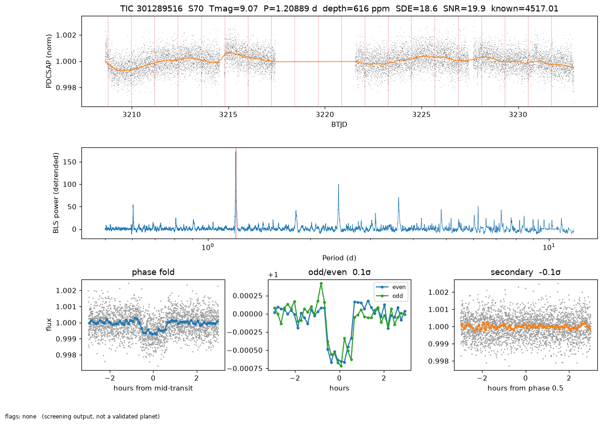

# exoplanet_search: TESS transit search (CPU first, GPU/MLX ready)

A small, honest pipeline that searches TESS SPOC 2-minute light curves for periodic
transit-like dips, screens out the usual false positives, and flags anything already known.
Its output is a **list of threshold-crossing signals to inspect by eye**, not discoveries.

```
MAST manifest -> seeded target subset -> resumable download (FITS on the shared disk)
   -> QUALITY mask + gap-edge trim + wotan biweight (0.75 d) + 10-min binning
   -> BLS over 0.5 d .. baseline/2 (one Dask task per star; cpu / cuda / mlx backends)
   -> vetting (SDE, SNR, odd/even, secondary, duration, depth, radius, systematics)
   -> cross-match ExoFOP TOI + CTOI and NASA Exoplanet Archive
   -> SQLite + Parquet + diagnostic PNGs for the top hits
```

## Layout

| path | what |
|---|---|
| `run_search.py` | CLI: whole pipeline for one sector |
| `exosearch/targets.py` | sector manifest, seeded subset, idempotent `.part`+rename downloads |
| `exosearch/lightcurve.py` | load PDCSAP, mask flagged cadences, trim gap edges, wotan biweight, binning |
| `exosearch/bls.py` | period grid, SDE, backend switch (`cpu` = astropy BLS) |
| `exosearch/bls_vector.py` | vectorized BLS on numpy (tested) / CuPy / MLX (untested stubs) |
| `exosearch/vet.py` | vetting metrics and flags, sector-wide common-period (systematics) flag |
| `exosearch/catalogs.py` | ExoFOP TOI/CTOI + Exoplanet Archive `pscomppars`, cached 7 days |
| `exosearch/task.py` | `process_star`: one star = one Dask task, picks backend from worker tags |
| `exosearch/store.py` | SQLite results (upsert on `tic, sector`, so reruns are resumable) |
| `scripts/` | scheduler / worker launchers, nightly batch, example systemd user timer |
| `exosearch/sectorqueue.py` | every TESS 2-min sector on MAST; next sectors to run, progress derived from the DB |
| `exosearch/deepvet.py` | candidate-only vetting: difference-image centroid, Gaia DR3 neighbours, TESS/Kepler EB match, V-shape, secondary scan, radius |
| `exosearch/selftest.py` | backend self-test + benchmark against astropy on known TOIs |
| `exosearch/export.py` | writes `site/data/progress.json`, `candidates.csv` and small candidate PNGs (no hostnames/paths) |
| `exosearch/learn_figs.py` | the Learn page figures, made from our own data |
| `site/` | static GitHub Pages site: dashboard, Learn, Run-it-yourself |
| `tests/` | pytest: injection-recovery, vetting, idempotent download, Dask end to end |

Data lives outside the repo, under `EXO_DATA_ROOT` (default `/media/nfs01/astro_data/tess`):
`sNNNN/lc/*.fits`, `catalogs/*.csv`, `results/exosearch.sqlite`, `results/results_sNNNN.parquet`,
`results/top_sNNNN.csv`, `results/plots/sNNNN/TIC*_sNNNN.png`.

## Run it (CPU only, on the coordinator)

```bash
cd exoplanet_search
python3 -m venv .venv && .venv/bin/pip install -r requirements.txt
EXO_OFFLINE=0 .venv/bin/python -m pytest -q tests          # ~30 s, needs network for 3 tests

# 1000 stars from sector 70 with 8 polite single-threaded workers
nice -n 19 .venv/bin/python run_search.py --sector 70 --n-targets 1000 --workers 8
```

Rerunning is cheap: cached FITS files are reused and stars already in the DB are skipped
(`--redo` forces a re-search, for example after changing vetting). Raising `--n-targets` with
the same `--seed` extends the same random subset.

### First run (sector 70, 1000 stars, CPU on the coordinator)

* 1000/1000 searched, 0 errors. Per-star task time median 0.71 s (mean 0.77 s) on one core;
  search wall 100 s with 8 workers. First-time download of 1000 FITS (~1.8 GB) took about 3.5 min.
* 17 stars in the subset host a TOI. 8 were recovered at the TOI period and passed all screens
  (TOI-465.01, 1908.01, 4517.01, 4537.01, 4598.01, 4617.01, 5360.01, 6310.01). The misses are
  mostly ultra-short periods (< 1 d) and 2-transit long periods, which this BLS setup handles
  poorly. That recovery rate is the honest sensitivity of v0.1.
* 2 signals passed screening without a TOI/CTOI match. Both are weak (SDE 9.2 and 9.7) and on
  inspection look like stellar variability / noise, not transits.
* The first pass piled BLS peaks up near 6.4 d and 12 d across unrelated stars (spacecraft
  systematics). Gap-edge trimming and the `common_period` flag were added because of it.



## Adding workers on other machines

Every star is an independent Dask task, so CPU, CUDA and MLX workers can all join one
scheduler and pull stars in parallel. With `--backend auto` (default) each worker chooses its
own backend from its **resource tags**: `GPU=1` -> CuPy BLS, `MLX=1` -> MLX BLS, none -> astropy
BLS. `--backend cuda` / `--backend mlx` instead pin every star to workers with that tag.

1. On the coordinator, start a standalone scheduler bound to the LAN or Tailscale address
   (it has no authentication: never bind it to a public interface or port-forward it):

   ```bash
   SCHED_HOST=<coordinator-lan-or-tailscale-ip> scripts/start_scheduler.sh     # :8786, dashboard :8797
   SCHEDULER=tcp://<coordinator-ip>:8786 scripts/start_worker_cpu.sh           # local CPU workers
   ```

2. On each extra machine: clone this repo and branch, create `exoplanet_search/.venv` with the
   same Python minor version (3.12) and the same `dask`/`distributed` versions as the
   coordinator, then start the matching worker script (below).
   Workers without the shared disk download FITS into their own `EXO_DATA_ROOT`; workers that
   mount the share can set `EXO_DATA_ROOT` to the mounted `astro_data/tess` path and reuse it.

3. Run the pipeline against the scheduler. `--upload-code` ships `exosearch/` to the workers if
   they are on an older checkout:

   ```bash
   nice -n 19 .venv/bin/python run_search.py --sector 70 --n-targets 3000 \
       --scheduler tcp://<coordinator-ip>:8786 --backend auto
   ```

### GPU worker (GTX 1050 Ti, Pascal sm_61, 4 GB)

* NVIDIA driver >= 525 and the CUDA 12.x runtime. `cupy-cuda12x` wheels still include sm_61.
  Check with `nvidia-smi` and
  `python -c "import cupy; print(cupy.cuda.runtime.getDeviceProperties(0)['major'])"` (should be 6).
* `pip install -r requirements.txt -r requirements-cuda.txt`
* `SCHEDULER=tcp://<coordinator-ip>:8786 scripts/start_worker_cuda.sh`
  (one process, `--resources GPU=1`, so the 4 GB card is never shared by two tasks).
* Validate before trusting it: `pytest tests/test_bls_vector.py` runs the CUDA-vs-numpy test
  once CuPy imports. The CUDA path is an **untested stub**. If it falls short, `cuvarbase`
  (commented in `requirements-cuda.txt`) is the mature alternative.
* Memory: a chunk is `chunk x n_points` floats (128 x ~3.5k binned points ~ 3.6 MB per array),
  far below 4 GB. Raise `chunk` in `bls_vector.search` for throughput.

### Apple Silicon worker (macOS, MLX)

```bash
brew install python@3.12
git clone <repo> && cd astro-compute-lab && git checkout exoplanet-search && cd exoplanet_search
python3.12 -m venv .venv
.venv/bin/pip install -r requirements.txt -r requirements-mlx.txt      # pip install mlx
.venv/bin/python -c "import mlx.core as mx; print(mx.default_device())" # Device(gpu, 0)
SCHEDULER=tcp://<coordinator-lan-or-tailscale-ip>:8786 scripts/start_worker_mlx.sh
```

Over Tailscale use the coordinator's `100.x` address, and bind the scheduler to it
(`SCHED_HOST`). The MLX path computes in float32 after subtracting the first timestamp on
the host, which keeps phase errors ~1e-6. It is an **untested stub**, so run
`pytest tests/test_bls_vector.py` on the Mac first. To also give the Mac CPU-only tasks, run
`scripts/start_worker_cpu.sh` beside the MLX worker.

## Progress site

`site/` is a static, buildless site (plain HTML/CSS + ES modules, Chart.js from a CDN) that reads
`site/data/progress.json` and small per-candidate light-curve files in `site/data/lc/`:

* **Dashboard**: a tile map of every TESS sector (done / in progress / queued, tap to filter),
  charts, and a candidate table you can search, filter (status, sector, flag, period, radius,
  Tmag, SDE) and sort; filter state lives in the URL hash, so a view can be shared.
* **Candidate view** (`candidate.html#s70/<tic>`): fold, zoom and re-bin the light curve, split
  odd/even transits, look at phase 0.5 and the whole sector, and read every check it passed or failed
  with an explanation, plus ExoFOP/MAST links and the diagnostic PNG.
* **Learn**: each pipeline stage with our own figures, plus live explorables (transit simulator,
  fold-it-yourself BLS, planet vs eclipsing binary, difference-image blend explainer) and a quiz.
* **Run it yourself**.

`assets/ui.js` holds the shared widgets (sliders with live values, segmented controls, readouts,
HiDPI canvases, an animation loop that respects reduced motion). `exosearch.export` writes the
light-curve JSON (~15 kB per listed candidate); the publisher commits it with the rest of `site/data`.
Preview locally:

```bash
.venv/bin/python -m exosearch.export && .venv/bin/python -m exosearch.learn_figs
python3 -m http.server -b 127.0.0.1 -d site 8000
```

`.github/workflows/exoplanet-pages.yml` deploys `exoplanet_search/site` to GitHub Pages on every
push to `exoplanet-search` that touches the site. To mark a candidate as submitted, add it to
`submissions.json` (`{"<tic>": {"where": "PHT Talk / ExoFOP CTOI", "ref": "<link>", "date": "YYYY-MM-DD"}}`).

`scripts/publish_site.sh` exports, runs a privacy guard (generic IP/path patterns plus an
untracked `private_patterns.txt` next to the data with one regex per line for machine/user
names), drops any PNG over 300 KB, then commits **only** `site/data` and `site/plots` and pushes
over HTTPS with `gh` credentials (works from timers without an ssh-agent).

## Sector queue and the continuous runner

```bash
.venv/bin/python -m exosearch.sectorqueue status        # done / in-progress sectors
.venv/bin/python -m exosearch.sectorqueue next --count 3
```

Order: sectors already started, then newest first. Progress comes from the results DB, so an
interrupted run resumes exactly where it stopped.

`scripts/continuous.sh` works through the queue **back to back, around the clock**, as a systemd
user service (`scripts/systemd/exosearch-continuous.service`, lingering enabled, no root):

* one instance (lock file shared with `nightly.sh`); `Nice=19`, `CPUSchedulingPolicy=idle`, idle I/O;
* 8 workers 07:00-23:00 local, 12 overnight when the 1-minute load is below 6; when reliability batches hold
  worker claims (`/tmp/exosearch-claims/<pid>.workers`) the runner takes `COMBINED_CAP` (16) minus the claimed
  workers, read at each sector start, so runner + batches never exceed 16 single-threaded processes;
* before each sector it waits while the 1-minute load is above 14 or the data disk has < 100 GB free;
* the next sector's FITS are prefetched while the current sector is searched;
* after each sector: FITS pruned, candidate deep vetting (`exosearch.deepvet --only-review`), site published.

```bash
cp scripts/systemd/exosearch-continuous.service ~/.config/systemd/user/
systemctl --user daemon-reload && systemctl --user enable --now exosearch-continuous.service
journalctl --user -u exosearch-continuous -f
systemctl --user stop exosearch-continuous     # pause (resumes where it left off)
```

Remote workers are **opt-in**: set `Environment=EXO_LISTEN=<lan-or-tailscale-ip>` in the unit and the
runner keeps a persistent scheduler on `EXO_LISTEN:8786` (dashboard :8797) with local CPU workers, which
GPU/MLX/CPU workers elsewhere can join. Default is localhost only; never bind to a public interface.

`scripts/nightly.sh` + `exosearch-nightly.timer` remain as a lighter alternative (01:30 nightly).

## Deep vetting (candidates only)

`python -m exosearch.deepvet --sector 70 [--only-review]` adds, per candidate:
difference-image centroid offset from the SPOC target-pixel file (flag > 0.5 px and > 3σ, or darkest
pixel > 1.5 px away), Gaia DR3 neighbours within 42" bright enough to cause the depth if fully eclipsed
(unresolvable inside 10"), TESS EB (Prša et al. 2022) / Kepler EB matches, V-shape ratio, a
secondary-eclipse scan over phases 0.15-0.85 and the companion radius from the TIC stellar radius
(flag > 2 R_Jup), transit-implied vs TIC stellar density (reject |z| > 4) and Gaia DR3 RUWE / non-single-star
(warnings). Rejecting flags move a "needs review" signal to "rejected" on the site.

## Pipeline v1.0.0 and reliability measurements

The pipeline is frozen at tag `exosearch-v1.0.0`. Every result row carries `pipeline_version`,
`config_hash` (hash of all thresholds and grids) and `git_hash`. Full commands, seeds and the archive
layout are in [`reproduce.md`](reproduce.md); every output column is defined in
[`analysis/SCHEMA.md`](analysis/SCHEMA.md).

* **Detection statistic.** For each trial duration D, `CDPP_D` = 1.48 x MAD of the running mean over D on
  the detrended, unbinned flux (so correlated noise counts). The statistic is
  `S = depth / (CDPP_D / sqrt(N_tr))`, with N_tr weighted by in-transit coverage. Signals are thresholded
  on S. SDE is still logged but no longer gates. `beta_D`, `sigma_w`, `CDPP_D` and `N_tr` are saved per candidate.
* **Threshold S\* (interim analysis layer, `python -m exosearch.interim`).** S\* is set so that one star per
  sector produces a false alarm after vetting. It comes from a generalized-Pareto fit to the tail of the
  max S of *vetted* inverted-null peaks, i.e. peaks that pass every check except the threshold. Only tuning
  stars that pass the star-quality cut are used, and a star-level bootstrap gives the CI. The current value,
  the null sample size and the CI are in `configs/interim_threshold_v1.json`. The analysis code supersedes it.
  The `s_min` in `configs/detection_threshold.json` is only the frozen v1.0.0 in-pipeline screening floor
  that sets `low_s`/`passed` while the search runs. It is not a detection threshold. Every S is stored,
  and detections are scored downstream at S\*.
* **Star-quality cut** (`configs/star_quality_v1.json`, registered before evaluation). Drop a star if
  beta_max > 3, measured on its own light curve (`python -m exosearch.quality`). The cut is applied
  identically to the real search population, the nulls and the injection hosts. In sector 70 it drops
  2,553 of 12,797 stars.
* **Completeness and false-alarm rate are paired.** Detected = right period and epoch with S >= S\*.
  Passed = detected and every check passes. The false-alarm rate is quoted post-vetting at the same S\*.
* **White-noise calibration** (`python -m exosearch.whitenoise`): see `docs/v1.1_odd_even_secondary.md`.
* **Injection-recovery** (`exosearch.inject`). One batman transit per light curve per run goes into
  normalised PDCSAP flux before masking and detrending. P, Rp, b and T0 are drawn as in
  `configs/injection_v1.json`, with Claret (2017) TESS limb darkening. Every injection goes through the
  full vetting chain. Each row records detected, passed-all-vetting, alias type and every failed check.
* **False alarms** (`exosearch.nulltest`). Inverted light curves, with flares masked first, are the
  primary null. Day-block scrambling is a limited secondary test with several seeded realizations. A
  per-star max-S table is saved for each null, and pass/fail is logged for every check on every null detection.
* **Stellar density and Gaia.** A batman fit gives a/R\*, and from it the transit-implied stellar
  density, which is compared with the TIC density. `density_mismatch` rejects when |z| > 4. Gaia DR3
  RUWE > 1.4 and non-single-star solutions are warnings.
* **Holdout.** A seeded random 20% of TIC IDs is held out (`holdout_tics.txt`, seed 20261110) and excluded
  from all tuning. Held-out metrics are reported separately for S70 and S106/107.
* **Batches.** `scripts/reliability_lane.sh` runs a queue of commands as a transient systemd user unit
  (`Nice=19`, idle CPU/I/O), backs off while the load is above 18 and retries. Batches are resumable
  (parquet parts, finished tasks skipped).
* **Summaries.** `python -m exosearch.reliability [--survivors]` writes `site/data/reliability.json` for
  the site's Methods page. If `analysis/make_reliability_json.py` exists, it is used instead (the
  hook for the analysis code: fits, GPD tail, bootstrap errors).

## One-command GPU / Mac workers

```bash
SCHEDULER=tcp://<scheduler-host>:8786 scripts/worker_cuda.sh       # NVIDIA (e.g. GTX 1050 Ti, sm_61)
SCHEDULER=tcp://<scheduler-host>:8786 scripts/worker_mlx_mac.sh    # Apple Silicon
```

Each checks the hardware/driver, builds `.venv` with the coordinator's dask version, runs
`exosearch.selftest` (backend vs astropy on known TOIs) and only joins if it passes. On Linux the MLX
code path can be exercised with `pip install "mlx[cpu]"` (it matches astropy on the sector-70 TOIs but
is ~6x slower than astropy on CPU, so it's for testing only).

## From signals to citizen science and publication (next steps, not done)

1. **Inspect by eye.** Open the diagnostic PNG of every passing, unmatched signal. Check
   the target in other sectors (`lightkurve.search_lightcurve(f"TIC {tic}")`) and look at
   centroids and pixel data for contamination (e.g. `lightkurve` TPF + `tpfplotter`/`TRICERATOPS`).
2. **Planet Hunters TESS** (Zooniverse): Talk boards let you discuss TIC IDs with
   the science team. That is the right venue for an amateur-found signal, and the team has
   promoted community finds to CTOIs before.
3. **ExoFOP community TOI (CTOI).** A registered ExoFOP account can submit a CTOI with
   period, epoch, depth, duration and notes. This only makes sense after multi-sector
   confirmation and pixel-level vetting, because CTOIs are public.
4. **Research Notes of the AAS (RNAAS).** These are short (<= 1000 words, 1 figure) refereed
   notes. Good fits: a well-vetted new candidate, or a methods note (for example, a GPU/MLX BLS
   cross-check on the same sector with recovery statistics against known TOIs).

## Known limitations

* The BLS duration grid is 1 to 6 h, the minimum period is 0.5 d, and passing needs >= 3
  transits. Ultra-short periods and 2-transit planets are under-recovered. Transit Least
  Squares (`transitleastsquares`) and multi-sector stitching are the natural upgrades.
* Each star gets one search pass, so a second planet in the same system is not searched for yet.
* Faint stars (Tmag > ~16) have unreliable PDCSAP normalisation and are mostly flagged `too_deep`.
* If the NASA Exoplanet Archive is down, planet cross-match is skipped with a warning; TOI
  dispositions (CP/KP) still cover most TESS-era planets.
